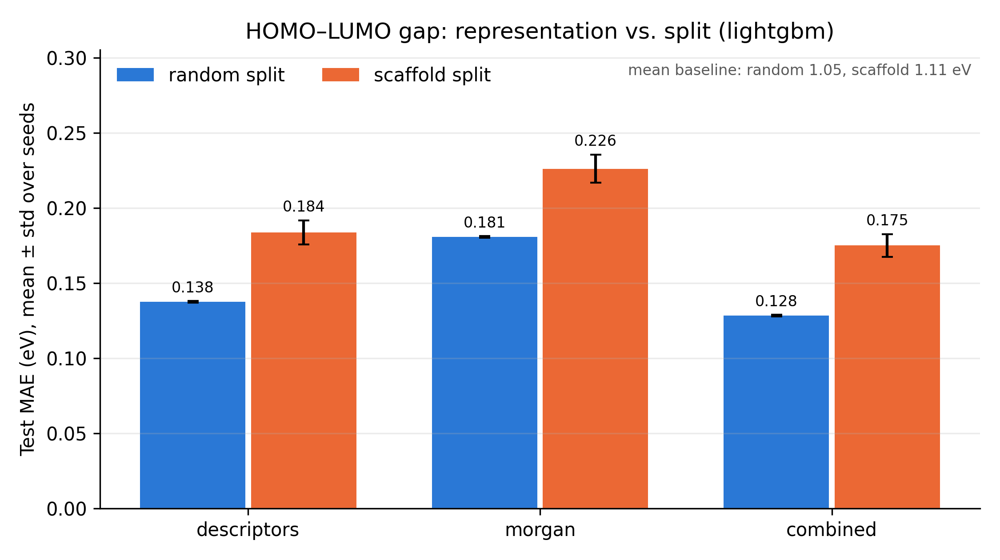

# How far do 2D molecular representations generalize?
### HOMO–LUMO gap prediction on QM9 under random and scaffold splits

**Koroush Mashayekh** — Department of Chemistry, University of Padova

Machine-learning models predict molecular properties well when the test molecules resemble the training set. In
drug and materials discovery, however, predictions are needed for **new types of molecules**. This project measures how
much accuracy is lost in that case, using the HOMO–LUMO gap of the QM9 dataset, and asks:

1. Which 2D representation (RDKit descriptors, Morgan fingerprints, or both) predicts the gap best?
2. How much accuracy is lost when test molecules have **ring systems never seen in training**?
3. Can similarity to the training data tell when a prediction is likely to be wrong?
4. Which chemical features drive the predictions and the largest errors?

## Key terms
| Term | Meaning |
|---|---|
| **HOMO–LUMO gap** | energy difference between the highest occupied and lowest unoccupied molecular orbital (here from DFT, B3LYP/6-31G(2df,p)); related to reactivity and optical properties |
| **Scaffold** | the ring system of a molecule (Bemis–Murcko framework); molecules without rings share the label `ACYCLIC` |
| **Random split** | test molecules are picked at random, so most have close relatives in training: measures *interpolation* |
| **Scaffold split** | whole scaffold families are held out, so every test molecule has a new ring system: measures *generalization* |
| **Scaffold penalty** | test error on the scaffold split minus test error on the random split |
| **MAE** | mean absolute error of the predicted gap, in eV (lower is better) |
| **Seed** | one random repetition of a split; every result is the mean ± standard deviation over 3 seeds |

## Key results
* **Best representation: RDKit descriptors + Morgan fingerprints** (called `combined` in the code), with LightGBM
  chosen by a validation-only protocol. Test MAE **0.128 ± 0.001 eV** on the random split and **0.175 ± 0.008 eV** on
  the scaffold split (R² 0.98 / 0.97), 6–8× better than predicting the mean gap.
* **The scaffold penalty is about 0.045 eV (+25–37%) for every representation**, and more training data closes it only
  slowly: on the scaffold split the error falls about one third more slowly as the training set grows.
* **Similarity to the training set explains only about one third of the penalty** and is a weak warning signal for
  single molecules (Spearman ρ ≈ −0.1).
* **The model has learned sensible chemistry** (saturation raises the gap; unsaturation, aromaticity and carbonyl
  groups lower it) but fails most on **new aromatic ring systems**, on very small and very large gaps (predictions
  shrink towards the mean), and on **strained polycyclic molecules** whose electronic structure depends on 3D geometry.



Every step, with all tables and figures, is described in **[docs/details.md](docs/details.md)**.

## Data and methods
* **Data:** QM9 (Ramakrishnan *et al.*, 2014), 133,885 small organic molecules, in the SDF + CSV version distributed by
  DeepChem for MoleculeNet (Wu *et al.*, 2018). The gap is converted from Hartree to eV.
* **Data quality:** 1,688 records that RDKit cannot read and 5,638 records that RDKit reads as radicals (impossible for
  closed-shell QM9 molecules; a known problem of this SDF file) are excluded and listed, leaving **126,559 molecules**.
* **Representations:** 190 RDKit 2D descriptors, a Morgan count fingerprint (radius 2, 2,048 bins), and both together.
* **Splits:** 80 / 10 / 10 % train / validation / test, random and balanced scaffold split, 3 seeds each, saved once and
  used by every experiment.
* **Model selection:** seven model families (Ridge, k-nearest neighbours, Random Forest, Extra Trees, LightGBM, XGBoost,
  neural network), each with the same budget of 8 hyperparameter settings, compared on the **validation** set. The
  decision rule was fixed in advance: lowest validation MAE on the scaffold split; within 0.01 eV, the fastest model.
  The test set is used only once, for the final scores.
* **Analyses:** learning curves (1,000 to 101,247 training molecules), error vs. similarity to the training set
  (Tanimoto, nearest neighbour), SHAP values and error analysis by chemical class.

## How to run

**On Google Colab (recommended, no installation)**
1. On this page click **Code → Download ZIP**, unzip it and upload the folder to Google Drive as
   `MyDrive/qm9-gap-generalization/`.
2. Open `notebooks/run_on_colab.ipynb` with Google Colab.
3. Run the cells in order. The first cells mount Drive, install the packages and download QM9
   (into `MyDrive/QM9_Molecular_Property_Prediction/data/raw/`). Results are written to
   `MyDrive/QM9_Molecular_Property_Prediction/v2/`.

**On your own computer** (Python ≥ 3.10)
```bash
git clone https://github.com/Koroush-Mashayekh/qm9-gap-generalization.git
cd qm9-gap-generalization
pip install -r requirements.txt
python scripts/00_download_data.py
python scripts/01_prepare_data.py
# ... then 02 to 07 in order
```
The data go to `data/raw/` and all results to `outputs/` inside the repository. Other folders can be set with the
environment variables `QM9_RAW_DIR` and `QM9_WORK_DIR`.

**Run time** on a standard Colab CPU runtime (approximate): step 1 ≈ 20 min, step 2 < 1 min, step 3 ≈ 2 h,
step 4 ≈ 3 h, step 5 ≈ 1.5 h, step 6 ≈ 15 min, step 7 ≈ 15 min. Every step saves its progress, so an interrupted run
continues where it stopped.

**Note:** result tables and predictions are created when the scripts run and are not stored in this repository; the
figures are in `figures/`, and the notebook shows the printed output of the final run.

## Repository
```
scripts/                          run in this order
    00_download_data.py           download QM9
    01_prepare_data.py            data quality checks, descriptors, fingerprints, scaffolds
    02_make_splits.py             random and scaffold splits (3 seeds)
    03_select_model.py            model selection on the validation set
    04_compare_representations.py the selected model on every representation, split and seed
    05_learning_curves.py         test error vs. training-set size
    06_applicability_domain.py    error vs. similarity to the training set
    07_chemical_analysis.py       SHAP, error by chemical class, worst predictions
src/qm9gap/                       shared code used by the scripts
    config.py                     all paths and settings
    chem.py                       RDKit functions (reading molecules, descriptors, fingerprints, scaffolds)
    splits.py, features.py, models.py, evaluate.py
notebooks/run_on_colab.ipynb      runs every step on Colab, with the outputs of the final run
docs/details.md                   detailed methods and results of every step
figures/                          figures of the final run
```

## Limitations and future work
QM9 contains only small molecules (up to nine heavy atoms) at one level of theory, and only 2D representations were
tested; the worst errors involve 3D effects (strain, non-planarity) that these representations do not encode. The
natural next steps are graph neural networks (e.g. Chemprop) and 3D-aware models on the same splits, and uncertainty
estimates as a stronger warning signal. See [docs/details.md](docs/details.md#limitations) for the full list.

## References
1. R. Ramakrishnan, P. O. Dral, M. Rupp, O. A. von Lilienfeld, *Quantum chemistry structures and properties of 134 kilo
   molecules*, Sci. Data **1**, 140022 (2014). https://doi.org/10.1038/sdata.2014.22
2. Z. Wu *et al.*, *MoleculeNet: a benchmark for molecular machine learning*, Chem. Sci. **9**, 513–530 (2018).
   https://doi.org/10.1039/C7SC02664A
3. G. W. Bemis, M. A. Murcko, *The properties of known drugs. 1. Molecular frameworks*, J. Med. Chem. **39**,
   2887–2893 (1996). https://doi.org/10.1021/jm9602928
4. D. Rogers, M. Hahn, *Extended-connectivity fingerprints*, J. Chem. Inf. Model. **50**, 742–754 (2010).
   https://doi.org/10.1021/ci100050t
5. K. Yang *et al.*, *Analyzing learned molecular representations for property prediction* (Chemprop; balanced scaffold
   split), J. Chem. Inf. Model. **59**, 3370–3388 (2019). https://doi.org/10.1021/acs.jcim.9b00237
6. G. Ke *et al.*, *LightGBM: a highly efficient gradient boosting decision tree*, NeurIPS (2017).
7. S. M. Lundberg *et al.*, *From local explanations to global understanding with explainable AI for trees*,
   Nat. Mach. Intell. **2**, 56–67 (2020). https://doi.org/10.1038/s42256-019-0138-9
8. RDKit: open-source cheminformatics. https://www.rdkit.org
9. DeepChem forum, *Recent critical bug fixes in DeepChem dataset and loaders (QM7/QM8/QM9 SDF issues resolved)*.
   https://forum.deepchem.io/t/recent-critical-bug-fixes-in-deepchem-dataset-and-loaders-qm7-qm8-qm9-sdf-issues-resolved/2387

## License
MIT (see `LICENSE`).
