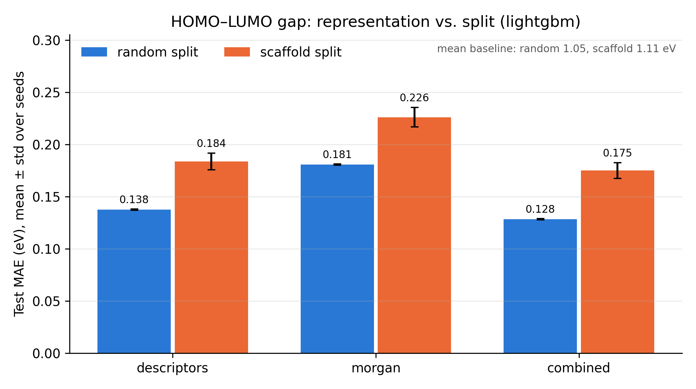
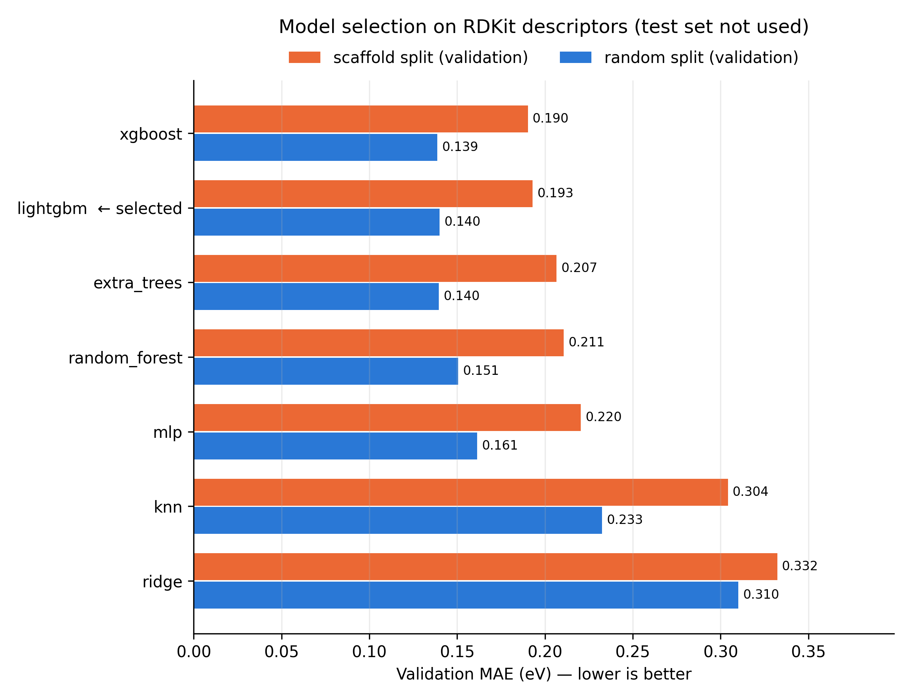
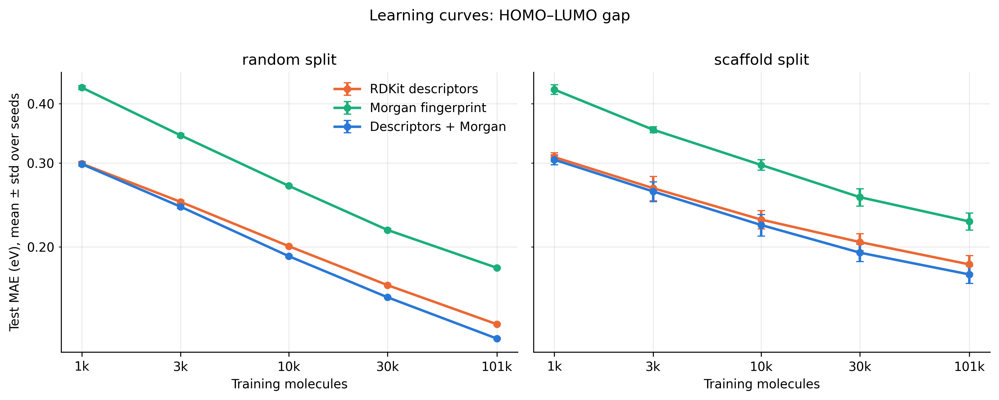
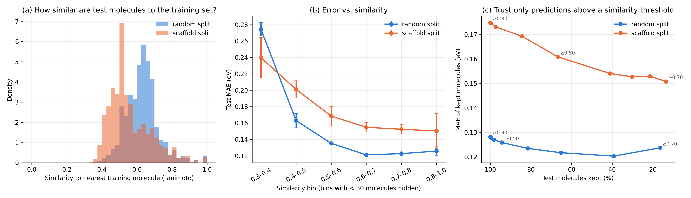
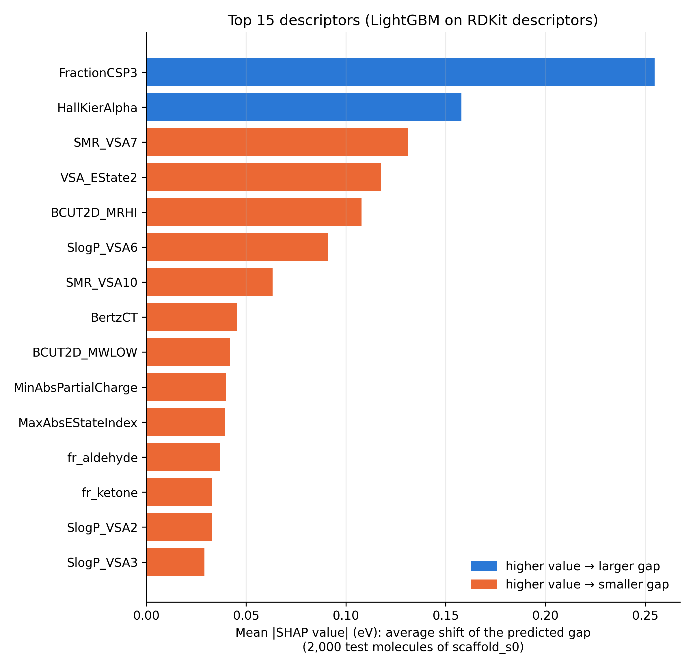
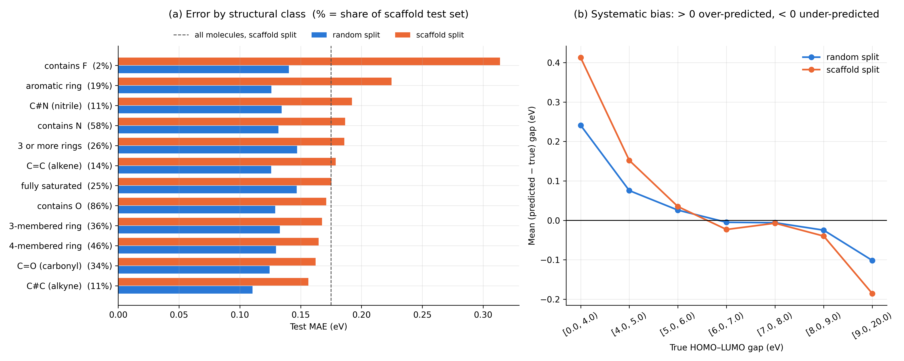
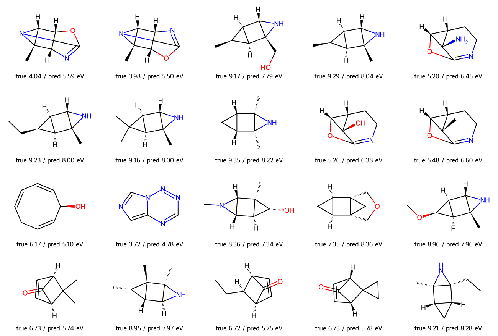

# How far do 2D molecular representations generalize?
### HOMO–LUMO gap prediction on QM9 under random and scaffold splits

**Koroush Mashayekh** — Department of Chemical Sciences, University of Padova

## Question
Machine-learning models trained on 2D molecular representations predict the DFT HOMO–LUMO gap
(B3LYP/6-31G(2df,p)) of QM9 molecules well when test molecules resemble the training set. In
drug and materials discovery, however, predictions are needed for **new chemotypes**. This project asks:

1. Which 2D representation (RDKit descriptors, Morgan fingerprints, or both) predicts the gap best?
2. How much accuracy is lost when test molecules have **ring scaffolds never seen in training**?
3. Can similarity to the training data tell when a prediction is likely to be wrong?
4. Which chemical features drive the predictions and the largest errors?

## Key results
* **Best representation: RDKit descriptors + Morgan fingerprints**, with LightGBM chosen by a validation-only
  protocol. Test MAE **0.128 ± 0.001 eV** (random split) and **0.175 ± 0.008 eV** (scaffold split), R² 0.98 / 0.97,
  6–8× better than a mean-value baseline.
* **Unseen scaffolds cost about 0.045 eV (+25–37%) for every representation**, and more data closes this gap only
  slowly: the error falls about one third more slowly with training-set size on the scaffold split.
* **Similarity to the training set explains only about one third of this penalty** and is a weak warning signal for
  single molecules (Spearman ρ ≈ −0.1).
* **The model has learned sensible chemistry** (saturation raises the gap; unsaturation, aromaticity and carbonyl
  groups lower it) but fails most on **new aromatic ring systems**, on very small and very large gaps (shrinkage
  towards the mean), and on **strained polycyclic molecules** whose electronic structure depends on 3D geometry.



## Protocol
* **Data:** QM9 (Ramakrishnan *et al.*, *Sci. Data* 2014), 133,885 molecules, in the SDF + CSV version distributed by
  DeepChem for MoleculeNet (Wu *et al.*, *Chem. Sci.* 2018); downloaded by `scripts/00_download_data.py`. The gap is
  converted from Hartree to eV. Molecules that RDKit cannot sanitize or reads as radicals are excluded and reported
  (126,559 kept).
* **Splits:** 80/10/10 train/validation/test, **random** and **balanced scaffold** (Bemis–Murcko), each with 3 seeds.
  All experiments use the same saved splits.
* **Model selection:** seven candidates (Ridge, kNN, Random Forest, Extra Trees, LightGBM, XGBoost, MLP), each with
  the same budget of 8 random hyperparameter configurations, compared on the **validation** set of the scaffold split.
  The decision rule was fixed before any result was seen (lowest validation MAE; within 0.01 eV, the fastest model wins).
  The test set is not used for any choice.
* **Representation comparison:** the selected model, unchanged, on every representation, split and seed.
* **Reporting:** MAE, RMSE, R² as mean ± standard deviation over seeds, always next to a mean-value baseline.

## Repository
```
src/qm9gap/
    config.py      all paths, constants and model settings
    chem.py        RDKit: SDF reading, SMILES, scaffolds, descriptors, Morgan fingerprints
    splits.py      random and scaffold splits
    features.py    load a representation as a feature matrix
    models.py      the seven candidate models and their search spaces
    evaluate.py    metrics and summaries
scripts/
    00_download_data.py           downloads QM9 (MoleculeNet/DeepChem SDF + CSV)
    01_prepare_data.py            QM9 -> molecules, descriptors, fingerprints (resumable)
    02_make_splits.py             fixed splits for all experiments
    03_select_model.py            model selection on the validation set
    04_compare_representations.py representation x split x seed experiments
    05_learning_curves.py         test error vs. training-set size
    06_applicability_domain.py    error vs. similarity to the training set
    07_chemical_analysis.py       SHAP, error by structural class, worst predictions
notebooks/
    run_on_colab.ipynb            runs every step on Google Colab, with the outputs of the final run
figures/                          the figures shown in this README
```

## How to run (Google Colab)
1. Run `scripts/00_download_data.py` (first cell of the notebook). It downloads
   `https://deepchemdata.s3-us-west-1.amazonaws.com/datasets/gdb9.tar.gz` and saves `qm9.sdf` and `qm9.sdf.csv` in
   `MyDrive/QM9_Molecular_Property_Prediction/data/raw/` (or in `QM9_RAW_DIR`).
2. Upload this repository to `MyDrive/qm9-gap-generalization/` and open `notebooks/run_on_colab.ipynb` in Colab.
3. Run the cells in order (several hours in total on a standard Colab runtime; every step is resumable).
   Outputs go to `MyDrive/QM9_Molecular_Property_Prediction/v2/` (or set `QM9_WORK_DIR`), outside the code folder.

## Step 1 — Data preparation (`scripts/01_prepare_data.py`)

**Goal:** read QM9 once, check data quality, and save clean molecular representations for all later steps.

**Input:** `qm9.sdf` (3D structures of the 133,885 QM9 molecules) and `qm9.sdf.csv` (their DFT properties,
B3LYP/6-31G(2df,p)); the target is the HOMO–LUMO gap.

**What the script does**
1. Reads every SDF record with RDKit and sanitizes it. Hydrogens are removed, so each molecule is described by its
   heavy-atom graph, exactly as it would be from a SMILES string; a new molecule is featurized in the same way.
2. Computes the canonical SMILES and Bemis–Murcko scaffold (molecules without rings: `ACYCLIC`), all 217 RDKit 2D
   descriptors, and a count-based Morgan fingerprint (radius 2, 2,048 bins).
3. Converts the gap from Hartree to eV (1 Ha = 27.211386 eV).
4. Removes molecules whose structure cannot be trusted (see below).
5. Removes descriptors that are constant over the whole dataset (uses no target information, so no leakage).

The SDF is processed in chunks of 10,000 records saved to disk, so an interrupted run resumes where it stopped
(about 20 min on Google Colab).

**Data quality**

| | Molecules |
|---|---|
| SDF records | 133,885 |
| Rejected by RDKit (sanitization failed) | 1,688 |
| Read as radicals (excluded) | 5,638 |
| **Kept** | **126,559** |

The kept molecules contain 14,505 different scaffolds; 13,594 molecules are acyclic. Mean gap 6.92 eV (std 1.25 eV).

All QM9 molecules are neutral closed-shell species, yet 5,638 records (4.2%) are read by RDKit with unpaired
electrons. Their molecular graph, and therefore every descriptor computed from it, does not describe the real
molecule, so they were excluded (listed in `excluded_radicals.csv`). The likely cause is that this SDF, which was
generated from the original XYZ coordinates, does not encode all bond orders or charges; DeepChem has since reported
bond and charge errors in this file and published a corrected version. Of the 217 descriptors, 27 are constant and were removed; the remaining 190 have
no missing values.

**Output** (`processed/`): `molecules.parquet` (mol_id, SMILES, scaffold, heavy atoms, gap in eV),
`descriptors.parquet` (190 descriptors), `morgan_counts.npy` (fingerprints, same row order),
`prepare_report.json` (all counts, removed descriptors, excluded IDs), `excluded_radicals.csv`.

## Step 2 — Train / validation / test splits (`scripts/02_make_splits.py`)

**Goal:** split the molecules once, so that every later experiment uses exactly the same molecules.

* **Fractions:** 80% train, 10% validation, 10% test.
* **Random split:** molecules are assigned at random; this measures how well a model *interpolates* between
  similar molecules.
* **Scaffold split** (balanced, as in Chemprop): whole Bemis–Murcko scaffold groups go to one part only. Groups larger
  than half of the validation or test size are placed first, so the large families end up in training; the remaining
  small groups are shuffled and fill the rest. Validation and test molecules therefore have ring systems never seen in
  training, which measures how well a model *generalizes* to new chemotypes.
* **Three seeds** (0, 1, 2) per split type; results are reported as mean ± standard deviation.
* **Roles:** *train* fits the model, *validation* is used for every choice (model, hyperparameters, early stopping),
  *test* is used only once, for the final score.

| Molecules per part | train | validation | test |
|---|---|---|---|
| random (each seed) | 101,247 | 12,656 | 12,656 |
| scaffold (each seed) | 101,247 | 12,655 | 12,657 |

A check confirms that no scaffold is shared between train, validation and test in any scaffold split.

**Output:** `processed/splits.parquet` (one column per split and seed) and `results/split_summary.csv`.

## Step 3 — Model selection (`scripts/03_select_model.py`)

**Goal:** choose the model with a fair protocol that was fixed before any result was seen.

* **Candidates (7 model families):** Ridge (linear), k-nearest neighbours, Random Forest, Extra Trees, LightGBM,
  XGBoost, and a feed-forward neural network (MLP). SVR and Gaussian processes were not included because their
  training cost grows at least quadratically with the number of molecules.
* **Equal budget:** each candidate tried 8 random hyperparameter settings (6 for Ridge, whose grid is smaller), all
  trained on the same 20,000 training molecules (RDKit descriptors, scaffold split, seed 0).
* **Scoring:** the best setting of each candidate was retrained on the full training set (101,247 molecules) and scored
  on the **validation** set of the scaffold and the random split. Boosters used 10% of the training data for early
  stopping. **The test set was not used.**
* **Decision rule (fixed in advance):** lowest validation MAE on the scaffold split; models within 0.01 eV of the best
  count as equally accurate, and the fastest of them to train is chosen.

| Model | Val. MAE, scaffold (eV) | Val. MAE, random (eV) | Val. R², scaffold | Training time (min) | Model size (MB) |
|---|---|---|---|---|---|
| XGBoost | **0.190** | 0.139 | 0.964 | 6.1 | 22 |
| LightGBM | 0.193 | 0.140 | 0.963 | 5.3 | 28 |
| Extra Trees | 0.207 | 0.140 | 0.957 | 16.8 | 1,813 |
| Random Forest | 0.211 | 0.151 | 0.955 | 25.7 | 2,579 |
| MLP | 0.220 | 0.161 | 0.951 | 12.0 | 7 |
| k-nearest neighbours | 0.304 | 0.233 | 0.897 | 0.2 | 76 |
| Ridge | 0.332 | 0.310 | 0.894 | 0.2 | 2 |

**Selected: LightGBM** (`learning_rate=0.03`, `num_leaves=63`, `min_child_samples=20`, `colsample_bytree=0.3`,
`reg_lambda=0`). XGBoost and LightGBM differ by 0.003 eV, below the 0.01 eV threshold, so they are equally accurate,
and LightGBM trains faster.

**Observations**
* **The model ranking depends on the split.** On the random split Extra Trees, XGBoost and LightGBM are tied
  (0.139–0.140 eV); on the scaffold split the two boosters are about 0.015 eV better. A model chosen on a random split
  alone could therefore be the wrong choice for new chemotypes.
* **Every nonlinear model is 30–50% less accurate on unseen scaffolds** than on the random split (Ridge only 7%,
  because it is already inaccurate on both).
* The boosters are also among the fastest to train and are about 100 times smaller than the forests.



**Output:** `results/model_selection/` (every configuration tried, full-training results, `model_selection_table.csv`,
`selected_model.json`) and `results/figures/fig0_model_selection.png`.

## Step 4 — Comparison of molecular representations (`scripts/04_compare_representations.py`)

**Goal:** find which 2D representation predicts the HOMO–LUMO gap best, and how much accuracy is lost on unseen scaffolds.

* **Model:** LightGBM with the hyperparameters selected in Step 3, unchanged for every representation.
* **Representations:** RDKit descriptors (190), Morgan count fingerprint (2,048), and both combined (2,238).
* **Protocol:** trained on *train*, early stopping on *validation*, scored once on *test*; random and scaffold split,
  3 seeds each; a mean-value baseline is scored on the same test sets.

| Test MAE (eV), mean ± std over 3 seeds | Random split | Scaffold split | Increase on unseen scaffolds |
|---|---|---|---|
| **Descriptors + Morgan** | **0.128 ± 0.001** | **0.175 ± 0.008** | +0.047 (+37%) |
| RDKit descriptors | 0.138 ± 0.001 | 0.184 ± 0.008 | +0.046 (+33%) |
| Morgan fingerprint | 0.181 ± 0.001 | 0.226 ± 0.009 | +0.045 (+25%) |
| Mean-value baseline | 1.053 ± 0.003 | 1.110 ± 0.012 | |

| Test R², mean ± std | Random split | Scaffold split |
|---|---|---|
| Descriptors + Morgan | 0.981 ± 0.000 | 0.968 ± 0.002 |
| RDKit descriptors | 0.978 ± 0.000 | 0.965 ± 0.002 |
| Morgan fingerprint | 0.963 ± 0.000 | 0.947 ± 0.005 |


**Findings**
* **Combining descriptors and fingerprints is best.** On the random split it is 0.010 eV better than descriptors alone,
  ten times the seed-to-seed spread. On the scaffold split the spread is larger (0.008 eV), but the comparison is
  *paired*: with the same split, the combined representation is better in every seed (by 0.009, 0.008 and 0.009 eV).
* **Morgan fingerprints alone are clearly the weakest** (about 0.045 eV worse than descriptors). A possible reason is
  that fingerprints count local substructures, whereas the gap depends on more global properties such as conjugation,
  which some descriptors encode more directly. This is tested in the interpretation step.
* **Unseen scaffolds cost about 0.045 eV for every representation.** The penalty is almost constant in absolute terms,
  so a better representation lowers the error overall but does not close the generalization gap.
* **Check of the 0.01 eV threshold used in Step 3:** the seed-to-seed spread is about 0.001 eV on the random split and
  about 0.008 eV on the scaffold split, so a threshold of 0.01 eV is of the same size as the real uncertainty.
* For descriptors on the scaffold split, the test MAE of seed 0 (0.193 eV) equals the validation MAE in Step 3
  (0.193 eV): model selection on the validation set did not make the test score optimistic.

**Output:** `results/representations_runs.csv` (every run), `results/representations_summary.csv` (mean ± std),
`results/figures/fig1_representations.png`, and the test predictions of every run in `results/runs/`.

## Step 5 — Learning curves (`scripts/05_learning_curves.py`)

**Goal:** measure how the test error falls as the training set grows, and whether more data helps as much for
molecules with unseen scaffolds.

* **Training-set sizes:** 1k, 3k, 10k, 30k and the full training set (101,247 molecules). Smaller sets are nested random
  subsets of the training set, different for each seed.
* **Same protocol as Step 4:** LightGBM from Step 3, early stopping on validation, the same test sets; the full-size
  point is taken from Step 4. All three representations, both splits, 3 seeds.
* **Summary of each curve:** power-law fit `MAE = a · n^(-b)`; a larger exponent *b* means the error falls faster.

| Test MAE (eV), mean ± std | Combined, random | Combined, scaffold | Gap between splits |
|---|---|---|---|
| 1,000 | 0.298 ± 0.002 | 0.305 ± 0.007 | 0.007 |
| 3,000 | 0.243 ± 0.002 | 0.261 ± 0.013 | 0.018 |
| 10,000 | 0.191 ± 0.001 | 0.222 ± 0.012 | 0.031 |
| 30,000 | 0.157 ± 0.000 | 0.194 ± 0.008 | 0.037 |
| 101,247 | 0.128 ± 0.001 | 0.175 ± 0.008 | 0.047 |

| Representation | *b*, random split | *b*, scaffold split | *b* lower on scaffolds by |
|---|---|---|---|
| Descriptors + Morgan | 0.184 | 0.122 | 34% |
| RDKit descriptors | 0.169 | 0.112 | 34% |
| Morgan fingerprint | 0.191 | 0.139 | 27% |



**Findings**
* **The gap between the splits grows with more data**, from 0.007 eV with 1,000 molecules to 0.047 eV with the full
  training set. With little data both splits are equally hard; additional data mainly improves interpolation between
  similar molecules.
* **On unseen scaffolds the error falls 27–34% more slowly** (smaller *b*) for every representation. Extrapolating the
  fit for the combined representation, halving the error would need about 40× more data on the random split but about
  300× more on the scaffold split. This extrapolation is rough, but it indicates that generalizing to new chemotypes
  requires better representations or models rather than just more data.
* **The benefit of adding Morgan fingerprints appears only with enough data:** combined and descriptors are equal at
  1,000 molecules (0.298 vs 0.299 eV) and differ by 0.010 eV with the full training set.
* **Morgan fingerprints alone stay clearly worst at every size**, although their curve is the steepest.

**Output:** `results/learning_curve_runs.csv`, `learning_curve_summary.csv`, `learning_curve_slopes.csv`,
`results/figures/fig2_learning_curves.png`.

## Step 6 — Applicability domain (`scripts/06_applicability_domain.py`)

**Goal:** check whether the error is larger for molecules that are unlike anything in the training set, and whether
this similarity can warn when a prediction should not be trusted.

* For every test molecule of Step 4 (LightGBM, descriptors + Morgan), the **Tanimoto similarity to the most similar
  training molecule** is computed (binary Morgan fingerprint, radius 2, 2,048 bits) and compared with the absolute
  prediction error. No new model is trained.

| Mean ± std over 3 seeds | Random split | Scaffold split |
|---|---|---|
| Median similarity to nearest training molecule | 0.63 ± 0.00 | 0.53 ± 0.02 |
| Test molecules with similarity < 0.5 | 6% | 33% |
| Spearman correlation, similarity vs. absolute error | −0.08 ± 0.01 | −0.13 ± 0.04 |
| Test MAE (eV) | 0.128 ± 0.001 | 0.175 ± 0.008 |

| Similarity bin | MAE, random (eV) | MAE, scaffold (eV) | Molecules, random | Molecules, scaffold |
|---|---|---|---|---|
| 0.3–0.4 | 0.274 ± 0.008 | 0.240 ± 0.025 | 34 | 341 |
| 0.4–0.5 | 0.163 ± 0.009 | 0.201 ± 0.010 | 681 | 3,867 |
| 0.5–0.6 | 0.135 ± 0.001 | 0.168 ± 0.012 | 3,683 | 4,622 |
| 0.6–0.7 | 0.121 ± 0.000 | 0.155 ± 0.006 | 6,283 | 2,146 |
| 0.7–0.8 | 0.123 ± 0.003 | 0.152 ± 0.006 | 1,360 | 1,011 |
| 0.8–1.0 | 0.126 ± 0.005 | 0.150 ± 0.021 | 613 | 667 |

(Bin 0–0.3 holds only 2–3 molecules per split and is not interpreted.)

| Keep only similarity ≥ | Random: kept | Random: MAE kept | Scaffold: kept | Scaffold: MAE kept |
|---|---|---|---|---|
| — (all) | 100% | 0.128 | 100% | 0.175 |
| 0.45 | 98% | 0.127 | 85% | 0.169 |
| 0.50 | 94% | 0.126 | 67% | 0.161 |
| 0.55 | 82% | 0.123 | 41% | 0.154 |
| 0.60 | 65% | 0.122 | 30% | 0.153 |
| 0.70 | 17% | 0.124 | 14% | 0.151 |



**Findings**
* **Scaffold-split test molecules are less similar to the training set** (median 0.53 vs. 0.63; a third of them below
  0.5 compared with 6% on the random split).
* **On average, the error grows as similarity falls**: on the scaffold split from 0.15 eV above 0.6 to 0.20–0.24 eV
  below 0.5. **For a single molecule, however, similarity is a weak signal** (Spearman ρ of only −0.08 to −0.13):
  errors scatter widely at every similarity level.
* **Lower similarity explains only about one third of the scaffold penalty.** At the *same* similarity, scaffold-split
  molecules are still about 0.03 eV harder (e.g. 0.168 vs. 0.135 eV at 0.5–0.6). Weighting the random-split error of
  each bin by the scaffold-split bin sizes gives an expected 0.144 eV, against an observed 0.175 eV: of the 0.047 eV
  penalty, about 0.016 eV is due to lower similarity and about 0.031 eV is not. A plausible reason is that Morgan
  similarity counts shared local substructures, while the gap depends strongly on the ring system itself
  (conjugation, strain), which is exactly what changes between scaffolds.
* **A similarity threshold helps only modestly.** Keeping scaffold-split molecules with similarity ≥ 0.5 retains 67% of
  them and lowers the MAE from 0.175 to 0.161 eV; the rejected third has 0.205 eV. Even the most similar scaffold-split
  molecules (≥ 0.7) remain less accurate (0.151 eV) than the random-split average (0.128 eV).
* **Conclusion:** nearest-neighbour Tanimoto similarity flags the worst cases but is not sufficient to tell when a
  prediction for a new chemotype can be trusted.

**Output:** `results/applicability_molecules.csv` (every test molecule), `applicability_summary.csv`,
`applicability_bins.csv`, `applicability_thresholds.csv`, `results/figures/fig3_applicability.png`.

## Step 7 — Chemical interpretation (`scripts/07_chemical_analysis.py`)

**Goal:** understand what drives the predictions and where the model fails.

### A. Which descriptors matter? (SHAP)
LightGBM trained on the 190 RDKit descriptors (scaffold split, seed 0; test MAE 0.193 eV, identical to Step 4);
SHAP values computed with LightGBM's built-in TreeSHAP on 2,000 random test molecules.

| Descriptor | Mean \|SHAP\| (eV) | Effect of a higher value | Chemical meaning |
|---|---|---|---|
| FractionCSP3 | 0.255 | larger gap | share of sp³ carbons: saturated σ-frameworks have large gaps |
| HallKierAlpha | 0.158 | larger gap | becomes more negative with sp²/sp atoms, i.e. with unsaturation |
| SMR_VSA7 | 0.131 | smaller gap | surface area of atoms with high molar-refractivity contributions (mostly sp²/aromatic C) |
| VSA_EState2 | 0.118 | smaller gap | surface area in one electrotopological-state bin |
| BCUT2D_MRHI | 0.108 | smaller gap | polarizability-weighted connectivity: more polarizable → smaller gap |
| SlogP_VSA6 | 0.091 | smaller gap | surface area in one lipophilicity bin |
| SMR_VSA10 | 0.063 | smaller gap | surface area of atoms with the highest molar refractivity |
| BertzCT | 0.046 | smaller gap | molecular complexity |
| fr_aldehyde, fr_ketone | 0.037, 0.033 | smaller gap | carbonyl groups: low-lying π* orbital |

The model has learned chemically sensible rules: **saturation raises the gap; unsaturation, aromaticity,
polarizability and carbonyl groups lower it.**



### B. Which molecules are hard?
Test errors of Step 4 (LightGBM, descriptors + Morgan, all splits and seeds), by structural class (a molecule can be
in several classes):

| Structural class | Share of scaffold test set | MAE random (eV) | MAE scaffold (eV) | Scaffold penalty (eV) |
|---|---|---|---|---|
| all molecules | 100% | 0.128 | 0.175 | +0.047 |
| contains F | 2% | 0.140 | 0.314 ± 0.065 | +0.174 |
| aromatic ring | 19% | 0.126 | 0.225 ± 0.024 | **+0.099** |
| C≡N (nitrile) | 11% | 0.134 | 0.192 | +0.058 |
| contains N | 58% | 0.132 | 0.187 | +0.055 |
| C=C (alkene) | 14% | 0.126 | 0.179 | +0.053 |
| C≡C (alkyne) | 11% | 0.111 | 0.156 | +0.046 |
| contains O | 86% | 0.129 | 0.171 | +0.042 |
| ≥ 3 rings | 26% | 0.147 | 0.186 | +0.039 |
| C=O (carbonyl) | 34% | 0.124 | 0.162 | +0.038 |
| 3-membered ring | 36% | 0.133 | 0.168 | +0.035 |
| 4-membered ring | 46% | 0.130 | 0.165 | +0.035 |
| fully saturated | 25% | 0.147 | 0.175 | **+0.029** |
| acyclic | 0% | 0.124 | — | — |

| True gap (eV) | Mean (predicted − true), random | Mean (predicted − true), scaffold |
|---|---|---|
| < 4 | +0.24 | +0.41 |
| 4–5 | +0.08 | +0.15 |
| 5–9 | −0.03 to +0.04 | −0.04 to +0.04 |
| ≥ 9 | −0.10 | −0.19 |



### C. The worst predictions
The 20 largest errors on the scaffold split (seed 0) are listed in `chemistry_worst_molecules.csv` and drawn in
`fig6_worst_molecules.png`. Their similarity to the nearest training molecule (0.29–0.67, mostly about 0.5) is
typical, so Step 6's similarity would not have flagged them.



**Findings**
* **New aromatic ring systems are the hardest case:** the scaffold penalty for molecules with an aromatic ring
  (+0.099 eV) is twice the average and more than three times that of fully saturated molecules (+0.029 eV).
  A plausible explanation is that the gap of an aromatic molecule depends on its whole delocalized π-system, which
  changes when the ring system changes, whereas the gap of a saturated molecule is set by more local, transferable
  features. Fluorinated molecules are also hard, but they are rare (2%) and their error varies strongly between seeds.
* **The model shrinks towards the average gap:** small gaps are over-predicted and large gaps under-predicted, and
  this bias doubles on the scaffold split (+0.41 eV below 4 eV, −0.19 eV above 9 eV). The low-gap molecules, often the
  most interesting ones for applications, are therefore the least accurate.
* **The worst predictions are strained, fused polycyclic molecules**, whose electronic structure depends on 3D
  geometry that 2D descriptors do not see. Several of the 20 share one cage motif (a cyclopropane fused to an
  aziridine), whose gap is under-predicted by about 1.0–1.4 eV. Others are bicyclic enones in which the C=C and C=O
  groups are not conjugated, and an eight-membered ring triene whose non-planar shape limits conjugation; for these,
  the model predicts too small a gap, as if the π-system were conjugated.
* The errors are not dominated by a few outliers: the worst 5% of scaffold-split molecules carry 17% of the total
  absolute error.
* **Caveat:** the balanced scaffold split places the large acyclic group in the training set, so the scaffold test
  sets contain no acyclic molecules, while 11% of the random test sets do. Part of the difference between the splits
  therefore reflects composition; the per-class comparison above controls for this.

**Output:** `results/chemistry_shap_importance.csv`, `chemistry_error_by_class.csv`, `chemistry_error_by_gap.csv`,
`chemistry_worst_molecules.csv`, figures `fig4_shap_importance.png`, `fig5_error_by_chemistry.png`,
`fig6_worst_molecules.png`.

## Pilot study (motivation for the protocol above)
A first pass with default hyperparameters, one 80/20 split per type and RDKit descriptors computed with explicit
hydrogens (132,197 molecules, 191 descriptors). **Single seed and no validation set, so these numbers only
motivated the design; they are not the final results.**

| Test MAE (eV) | random split | scaffold split |
|---|---|---|
| mean baseline | 1.072 | 1.106 |
| Ridge | 0.332 | 0.398 |
| Random Forest | 0.159 | 0.304 |
| Extra Trees | 0.146 | 0.287 |
| HistGradientBoosting | 0.192 | 0.287 |
| XGBoost | 0.179 | 0.284 |
| LightGBM | 0.211 | 0.291 |

What the pilot showed:
* The error roughly **doubles** for molecules with unseen scaffolds, for every model.
* On the scaffold split the tree models lie within about 0.02 eV of each other, so the ranking from a random split
  does not carry over. A fair, validation-based model selection is therefore needed (step 3).
* Many of the largest errors come from records that RDKit reads as **radicals**, i.e. a wrong molecular graph.
  These are now detected and excluded in step 1. Others are strained polycyclic cage molecules,
  whose gap the model overestimates by up to about 4 eV.
* Errors are much larger for small gaps (< 3 eV: MAE ≈ 2.7 eV), which are rare in QM9.

## Limitations
* **One dataset of small molecules:** QM9 contains molecules with at most nine heavy atoms (C, N, O, F) and one level
  of theory (B3LYP/6-31G(2df,p)); the conclusions may not transfer to larger, drug-like molecules.
* **2D representations only:** the worst errors involve strain and non-planarity, which 2D descriptors do not encode.
* **Model selection on one representation and split:** LightGBM was chosen on RDKit descriptors (scaffold split,
  seed 0) and then used unchanged for the other representations; it may not be the best model for each of them.
* **The 0.01 eV tolerance** of the decision rule was set after the pilot study but before the model-selection run;
  the seed-to-seed spread measured later (0.008 eV) supports this choice.
* **Composition of the scaffold test sets:** the balanced scaffold split places all acyclic molecules in training,
  so per-class comparisons (Step 7) are more reliable than the overall difference between the splits.
* **5,638 records were excluded** because RDKit reads them as radicals. This matches the bond and charge errors that
  DeepChem later reported in this SDF, but it was not verified molecule by molecule; the excluded molecules may be
  of a particular kind (e.g. zwitterionic structures), which slightly narrows the chemical space studied.

## Future work
* **Graph neural networks** (e.g. Chemprop) or **3D-aware models** (e.g. SchNet), to test whether learned
  representations reduce the penalty on new scaffolds, in particular for aromatic and strained ring systems.
* **Uncertainty estimates** (model ensembles, conformal prediction) as a stronger warning signal than similarity.
* **Recover the excluded molecules** from the corrected DeepChem SDF or from the SMILES stored in the original QM9
  XYZ files, instead of perceiving bonds from coordinates.
* **Larger and more drug-like datasets** to test whether the scaffold penalty grows with chemical diversity.
