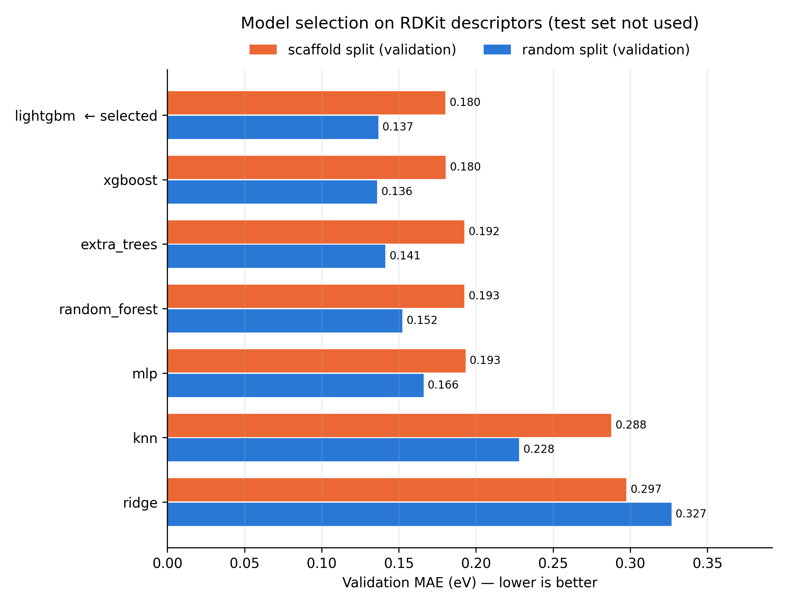
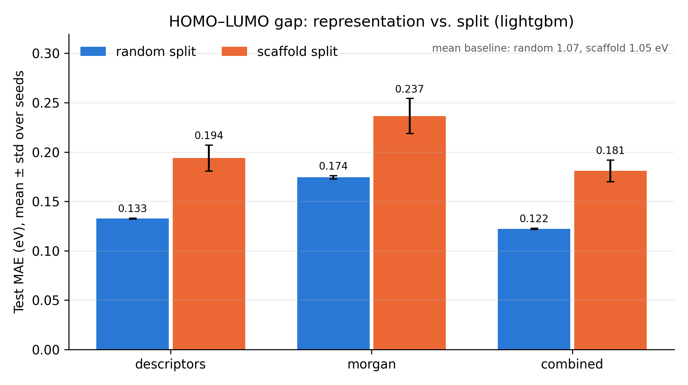
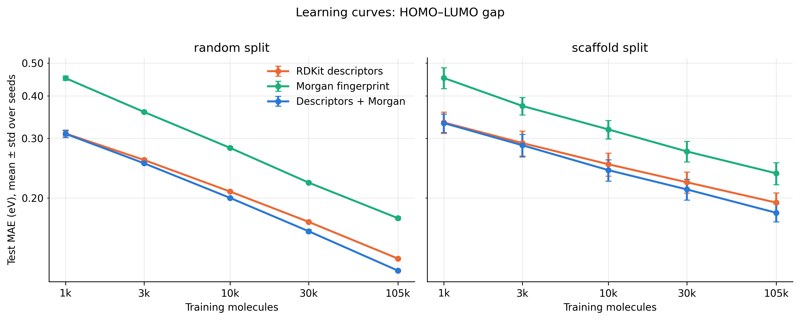
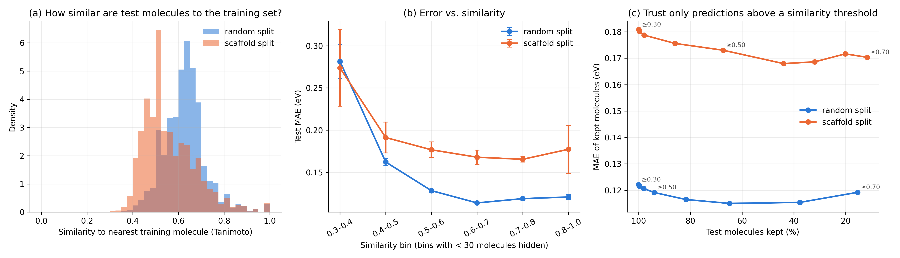
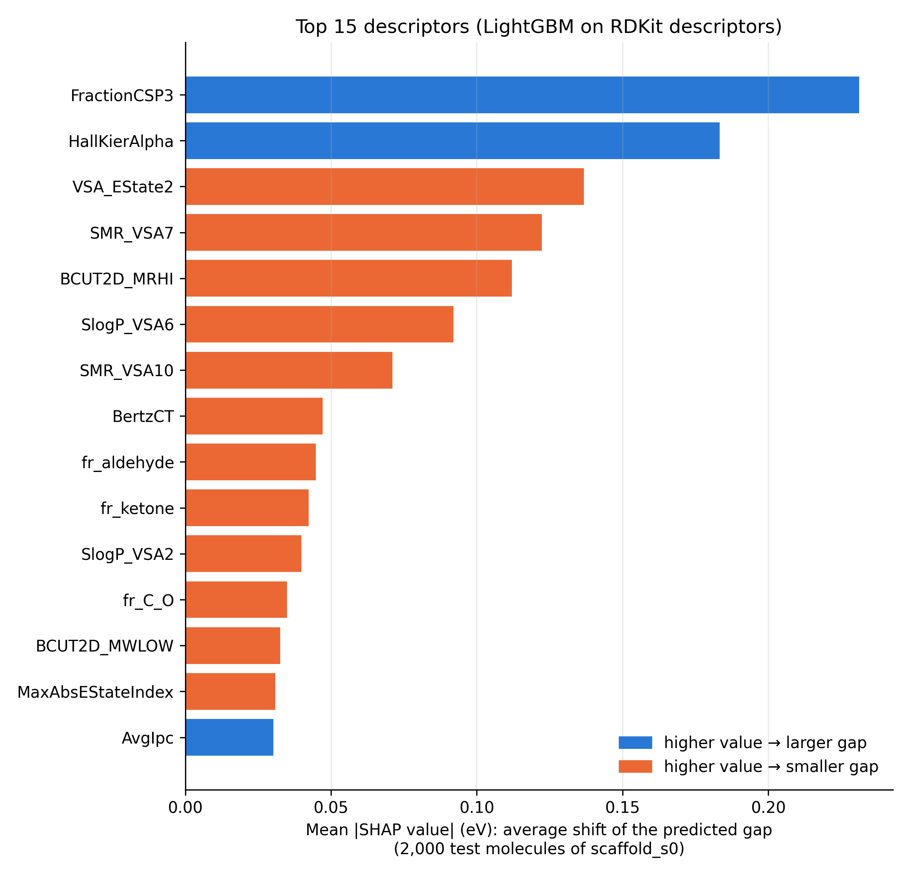
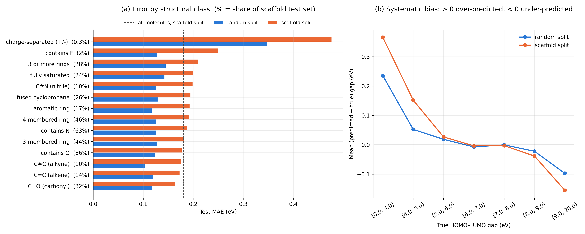
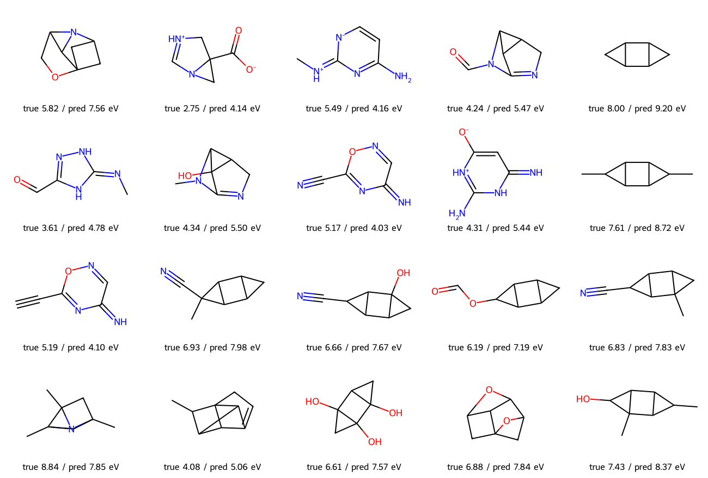

# Detailed methods and results

This file describes every step of the project in detail. For an overview, see the [README](../README.md).

**Paths:** each script writes its outputs to the work folder (`QM9_Molecular_Property_Prediction/v3/` on Colab,
`outputs/` on a local computer); `processed/` and `results/` below are inside that folder. These files are created
when the scripts run and are not stored in the repository; only the figures are (in `figures/`).

**Names:** "Descriptors + Morgan" is called `combined` in the code. The *scaffold penalty* is the test MAE on the
scaffold split minus the test MAE on the random split.

## Step 0 — Data source (`scripts/00_download_data.py`)

The data are the official QM9 files of Ramakrishnan *et al.* (2014) on figshare: one `.xyz` file per molecule
(133,885 molecules) and `uncharacterized.txt`. Each `.xyz` file contains the 3D coordinates, the computed properties
(B3LYP/6-31G(2df,p); HOMO, LUMO and gap in Hartree) and two SMILES: the **GDB-17 SMILES** of the intended structure and
the SMILES perceived from the optimized geometry. The script collects index, both SMILES, HOMO, LUMO and gap into one
table, `data/raw/qm9.csv`.

**Why this source.** A first version of the project used the SDF file distributed by DeepChem for MoleculeNet. In that
file the bonds were perceived from the 3D coordinates, and RDKit rejected 1,688 records and read 5,638 more as radicals,
which is impossible for closed-shell QM9 molecules; together 5.5% of the data were lost, and not at random. DeepChem's
corrected version of the file gave exactly the same counts. The GDB-17 SMILES define every bond explicitly: all
130,831 characterized molecules are read without a single problem (see the comparison at the end of Step 1).

## Step 1 — Data preparation (`scripts/01_prepare_data.py`)

**Goal:** read QM9 once, check data quality, and save clean molecular representations for all later steps.

**What the script does**
1. Excludes the **3,054 "uncharacterized" molecules** listed by the QM9 authors, whose structure changed during the DFT
   geometry optimization (rearranged or dissociated), so their computed gap does not belong to the molecule in the
   SMILES. This is standard practice for QM9; all 91 molecules whose optimized geometry falls apart into several pieces
   are in this list.
2. Reads every other molecule from its GDB-17 SMILES with RDKit and checks it (radical, several pieces, net charge):
   **no molecule failed**.
3. Computes the canonical SMILES, the Bemis–Murcko scaffold (molecules without rings: `ACYCLIC`), all 217 RDKit 2D
   descriptors and a count-based Morgan fingerprint (radius 2, 2,048 bins). A new molecule given as SMILES is
   featurized with exactly the same functions (`src/qm9gap/chem.py`).
4. Converts the gap from Hartree to eV (1 Ha = 27.211386 eV).
5. Removes descriptors that are constant over the whole dataset (uses no target information, so no leakage).

The molecules are processed in chunks of 10,000 saved to disk, so an interrupted run resumes where it stopped
(about 20 min on Google Colab).

| | Molecules |
|---|---|
| QM9 molecules | 133,885 |
| Uncharacterized (excluded) | 3,054 |
| Structure problems found | 0 |
| **Kept** | **130,831** |

The kept molecules contain 15,661 different scaffolds; 13,390 are acyclic. Mean gap 6.86 eV (std 1.28 eV). Of the 217
descriptors, 29 are constant and were removed; the remaining 188 have no missing values.

**Effect of the data source.** Compared with the first version (DeepChem SDF), 4,272 more molecules and 1,156 more
scaffolds are kept, and the mean gap is slightly lower (6.86 vs. 6.92 eV): the molecules lost in the SDF version were
not a random sample. Their return changes the results (Step 4): the error on the random split falls slightly
(0.128 → 0.122 eV), but the scaffold penalty grows (0.047 → 0.059 eV). Among the molecules that came back are
charge-separated structures (zwitterions), the hardest class of all (Step 7). The filtered SDF data had therefore
underestimated how hard new scaffolds are.

**Output** (`processed/`): `molecules.parquet` (mol_id, SMILES, scaffold, heavy atoms, gap in eV),
`descriptors.parquet` (188 descriptors), `morgan_counts.npy` (fingerprints, same row order),
`prepare_report.json` (all counts, removed descriptors).

## Step 2 — Train / validation / test splits (`scripts/02_make_splits.py`)

**Goal:** split the molecules once, so that every later experiment uses exactly the same molecules.

* **Fractions:** 80% train, 10% validation, 10% test.
* **Random split:** molecules are assigned at random; this measures how well a model *interpolates* between
  similar molecules.
* **Scaffold split** (balanced, as in Chemprop): whole Bemis–Murcko scaffold groups go to one part only. Groups larger
  than half of the validation or test size are placed first, so the large families end up in training; the remaining
  small groups are shuffled and fill the rest. Validation and test molecules therefore have ring systems never seen in
  training, which measures how well a model *generalizes* to new chemotypes.
* **Three seeds** (0, 1, 2) per split type; results are reported as mean ± standard deviation.
* **Roles:** *train* fits the model, *validation* is used for every choice (model, hyperparameters, early stopping),
  *test* is used only once, for the final score.

| Molecules per part | train | validation | test |
|---|---|---|---|
| random (each seed) | 104,665 | 13,083 | 13,083 |
| scaffold (each seed) | 104,664 | 13,083 | 13,084 |

A check confirms that no scaffold is shared between train, validation and test in any scaffold split. The scaffold
test sets hold 1,750–2,185 different scaffolds depending on the seed, so their difficulty varies between seeds.

**Output:** `processed/splits.parquet` (one column per split and seed) and `results/split_summary.csv`.

## Step 3 — Model selection (`scripts/03_select_model.py`)

**Goal:** choose the model with a fair protocol that was fixed before any result was seen.

* **Candidates (7 model families):** Ridge (linear), k-nearest neighbours, Random Forest, Extra Trees, LightGBM,
  XGBoost, and a feed-forward neural network (MLP). SVR and Gaussian processes were not included because their
  training cost grows at least quadratically with the number of molecules.
* **Equal budget:** each candidate tried 8 random hyperparameter settings (6 for Ridge, whose grid is smaller), all
  trained on the same 20,000 training molecules (RDKit descriptors, scaffold split, seed 0).
* **Scoring:** the best setting of each candidate was retrained on the full training set (104,664 molecules) and scored
  on the **validation** set of the scaffold and the random split. Boosters used 10% of the training data for early
  stopping (at most 10,000 trees). **The test set was not used.**
* **Decision rule (fixed in advance):** lowest validation MAE on the scaffold split; models within 0.01 eV of the best
  count as equally accurate, and the fastest of them to train is chosen.

| Model | Val. MAE, scaffold (eV) | Val. MAE, random (eV) | Training time (min) | Model size (MB) |
|---|---|---|---|---|
| LightGBM | **0.180** | 0.137 | 10.5 | 56 |
| XGBoost | 0.180 | **0.136** | 12.4 | 44 |
| Extra Trees | 0.193 | 0.141 | 17.5 | 1,874 |
| Random Forest | 0.193 | 0.152 | 26.8 | 2,667 |
| MLP | 0.193 | 0.166 | 22.9 | 6 |
| k-nearest neighbours | 0.288 | 0.228 | 0.2 | 77 |
| Ridge | 0.297 | 0.327 | 0.3 | 1 |

**Selected: LightGBM** (`learning_rate=0.03`, `num_leaves=63`, `min_child_samples=20`, `colsample_bytree=0.3`,
`reg_lambda=0`). LightGBM and XGBoost differ by 0.0002 eV, far below the 0.01 eV threshold, so they count as equally
accurate, and LightGBM trains faster. The first version of the data (DeepChem SDF) led to the same choice.

**Observations**
* **The ranking depends on the split.** The MLP ties with the forests on the scaffold split (0.193 eV) but is the
  weakest nonlinear model on the random split; the boosters lead the forests by 0.012 eV on the scaffold split but by
  only about 0.005 eV on the random split. A model chosen on a random split alone could be the wrong choice for new
  chemotypes.
* **The nonlinear models are 16–36% less accurate on unseen scaffolds.** Ridge is the exception (slightly better on
  the scaffold split); it is inaccurate on both splits and was not studied further.

**Output:** `results/model_selection/` (every configuration tried, full-training results, `model_selection_table.csv`,
`selected_model.json`) and `results/figures/fig0_model_selection.png`.

## Step 4 — Comparison of molecular representations (`scripts/04_compare_representations.py`)

**Goal:** find which 2D representation predicts the HOMO–LUMO gap best, and how much accuracy is lost on unseen scaffolds.

* **Model:** LightGBM with the hyperparameters selected in Step 3, unchanged for every representation.
* **Representations:** RDKit descriptors (188), Morgan count fingerprint (2,048), and both combined (2,236).
* **Protocol:** trained on *train*, early stopping on *validation*, scored once on *test*; random and scaffold split,
  3 seeds each; a mean-value baseline is scored on the same test sets.

| Test MAE (eV), mean ± std over 3 seeds | Random split | Scaffold split | Scaffold penalty |
|---|---|---|---|
| Mean-value baseline | 1.072 ± 0.004 | 1.049 ± 0.055 | |
| Morgan fingerprint | 0.174 ± 0.002 | 0.237 ± 0.018 | +0.063 (+36%) |
| RDKit descriptors | 0.133 ± 0.001 | 0.194 ± 0.013 | +0.061 (+46%) |
| **Descriptors + Morgan** | **0.122 ± 0.001** | **0.181 ± 0.011** | +0.059 (+48%) |

R² of the best representation: 0.983 (random) and 0.963 (scaffold).

**Findings**
* **Combining descriptors and fingerprints is best.** The comparison is *paired*: with the same split, the combined
  representation is better than descriptors alone in every seed, by 0.010–0.011 eV on the random split and by
  0.010–0.015 eV on the scaffold split.
* **Morgan fingerprints alone are clearly the weakest** (about 0.04 eV worse than descriptors). A possible reason is
  that fingerprints count local substructures, whereas the gap depends on more global properties such as conjugation,
  which some descriptors encode more directly.
* **Unseen scaffolds cost about 0.06 eV for every representation.** The penalty is almost constant in absolute terms,
  so a better representation lowers the error overall but does not close the generalization gap.
* **The scaffold results vary more between seeds** (± 0.011 eV against ± 0.001 eV): each seed puts different chemical
  families into the test set; even the mean-value baseline varies from 0.99 to 1.10 eV. Seed 2 is the easiest for every
  representation. The 0.01 eV threshold of Step 3 is of the same size as this real uncertainty.

**Output:** `results/representations_runs.csv` (every run), `results/representations_summary.csv` (mean ± std),
`results/figures/fig1_representations.png`, and the test predictions of every run in `results/runs/`.

## Step 5 — Learning curves (`scripts/05_learning_curves.py`)

**Goal:** measure how the test error falls as the training set grows, and whether more data helps as much for
molecules with unseen scaffolds.

* **Training-set sizes:** 1k, 3k, 10k, 30k and the full training set (~104,665 molecules). Smaller sets are nested
  random subsets of the training set, different for each seed.
* **Same protocol as Step 4:** LightGBM from Step 3, early stopping on validation, the same test sets; the full-size
  point is taken from Step 4. All three representations, both splits, 3 seeds.
* **Summary of each curve:** power-law fit `MAE = a · n^(-b)`; a larger exponent *b* means the error falls faster.

| Test MAE (eV), descriptors + Morgan | Random split | Scaffold split |
|---|---|---|
| 1,000 molecules | 0.309 ± 0.008 | 0.333 ± 0.021 |
| 3,000 | 0.253 ± 0.001 | 0.286 ± 0.022 |
| 10,000 | 0.200 ± 0.001 | 0.242 ± 0.017 |
| 30,000 | 0.160 ± 0.002 | 0.212 ± 0.015 |
| full (~104,665) | 0.122 ± 0.001 | 0.181 ± 0.011 |

| Exponent *b* | Random split | Scaffold split | Slower on scaffolds |
|---|---|---|---|
| Descriptors + Morgan | 0.200 | 0.131 | 34% |
| RDKit descriptors | 0.183 | 0.117 | 36% |
| Morgan fingerprint | 0.205 | 0.138 | 33% |

**Findings**
* **The gap between the splits grows with more data**, from 0.024 eV with 1,000 molecules to 0.059 eV with the full
  training set. Additional data mainly improves interpolation between similar molecules.
* **On unseen scaffolds the error falls about one third more slowly** for every representation. Extrapolating the
  fit for the combined representation, halving the error would need about 30× more data on the random split but about
  200× more on the scaffold split. This extrapolation is rough, but it indicates that generalizing to new chemotypes
  requires better representations or models rather than just more data.
* **The benefit of adding Morgan fingerprints appears only with enough data:** combined and descriptors are equal at
  1,000 molecules (0.309 vs 0.310 eV) and differ by 0.011 eV with the full training set.
* **Morgan fingerprints alone stay clearly worst at every size**, although their curve is the steepest.

**Output:** `results/learning_curve_runs.csv`, `learning_curve_summary.csv`, `learning_curve_slopes.csv`,
`results/figures/fig2_learning_curves.png`.

## Step 6 — Applicability domain (`scripts/06_applicability_domain.py`)

**Goal:** check whether the error is larger for molecules that are unlike anything in the training set, and whether
this similarity can warn when a prediction should not be trusted.

* For every test molecule of Step 4 (LightGBM, descriptors + Morgan), the **Tanimoto similarity to the most similar
  training molecule** is computed (binary Morgan fingerprint, radius 2, 2,048 bits) and compared with the absolute
  prediction error. No new model is trained.

| | Random split | Scaffold split |
|---|---|---|
| Median similarity to the training set | 0.63 | 0.53 |
| Share of test molecules below 0.5 | 6% | 33% |
| Spearman ρ (similarity, absolute error) | −0.08 | −0.07 |

| Test MAE (eV) by similarity | Random split | Scaffold split |
|---|---|---|
| 0.3–0.4 | 0.281 | 0.274 |
| 0.4–0.5 | 0.162 | 0.191 |
| 0.5–0.6 | 0.128 | 0.177 |
| 0.6–0.7 | 0.114 | 0.168 |
| 0.7–0.8 | 0.119 | 0.165 |
| 0.8–1.0 | 0.121 | 0.177 |

(Bin 0–0.3 holds only 1–6 molecules per split and is not interpreted.)

**Findings**
* **Scaffold-split test molecules are less similar to the training set**, and on average the error grows as
  similarity falls. **For a single molecule, however, similarity is a weak signal** (Spearman ρ ≈ −0.07).
* **Lower similarity explains only about a quarter of the scaffold penalty.** At the *same* similarity, scaffold-split
  molecules are still about 0.05 eV harder. Weighting the random-split error of each bin by the scaffold-split bin
  sizes gives an expected 0.138 eV against an observed 0.181 eV: of the 0.059 eV penalty, about 0.016 eV is due to lower
  similarity. Even scaffold-split molecules with similarity above 0.8 have 0.177 eV. Morgan similarity counts shared
  local substructures, while the gap depends strongly on the ring system itself (conjugation, strain), which is exactly
  what changes between scaffolds.
* **A similarity threshold helps only modestly.** Keeping scaffold-split molecules with similarity ≥ 0.5 retains 67%
  of them and lowers the MAE only from 0.181 to 0.173 eV.

**Output:** `results/applicability_molecules.csv` (every test molecule), `applicability_summary.csv`,
`applicability_bins.csv`, `applicability_thresholds.csv`, `results/figures/fig3_applicability.png`.

## Step 7 — Chemical interpretation (`scripts/07_chemical_analysis.py`)

**Goal:** understand what drives the predictions and where the model fails.

### A. Which descriptors matter? (SHAP)
LightGBM trained on the 188 RDKit descriptors (scaffold split, seed 0; test MAE 0.198 eV, identical to Step 4);
SHAP values computed with LightGBM's built-in TreeSHAP on 2,000 random test molecules.

| Descriptor | Mean \|SHAP\| (eV) | Higher value → | Meaning |
|---|---|---|---|
| FractionCSP3 | 0.231 | larger gap | share of sp³ carbons (saturation) |
| HallKierAlpha | 0.183 | larger gap | becomes more negative with sp² and sp atoms (unsaturation) |
| VSA_EState2 | 0.137 | smaller gap | surface of atoms with a given electrotopological state |
| SMR_VSA7 | 0.122 | smaller gap | surface of highly polarizable atoms (mostly aromatic/sp² carbon) |
| BCUT2D_MRHI | 0.112 | smaller gap | highest polarizability eigenvalue |
| fr_aldehyde, fr_ketone | 0.045, 0.042 | smaller gap | carbonyl groups (low-lying π*) |

The model has learned chemically sensible rules: **saturation raises the gap; unsaturation, aromaticity,
polarizability and carbonyl groups lower it.** The ranking is the same as with the first version of the data.

### B. Which molecules are hard?
Test errors of Step 4 (LightGBM, descriptors + Morgan, all splits and seeds), by structural class (a molecule can be
in several classes):

| Class | Share of scaffold test | MAE random (eV) | MAE scaffold (eV) | Scaffold penalty (eV) |
|---|---|---|---|---|
| All molecules | 100% | 0.122 | 0.181 | 0.059 |
| **Charge-separated (+/−, e.g. zwitterions)** | 0.3% | **0.348** | **0.476** | **0.129** |
| Contains F | 1.5% | 0.127 | 0.250 | 0.122 |
| Aromatic ring | 17% | 0.117 | 0.193 | 0.076 |
| C≡N (nitrile) | 10% | 0.125 | 0.199 | 0.074 |
| C≡C (alkyne) | 10% | 0.104 | 0.176 | 0.072 |
| Fused cyclopropane | 26% | 0.129 | 0.194 | 0.066 |
| 3 or more rings | 28% | 0.145 | 0.210 | 0.065 |
| Fully saturated | 24% | 0.143 | 0.199 | 0.057 |
| C=C (alkene) | 14% | 0.120 | 0.173 | 0.052 |
| C=O (carbonyl) | 32% | 0.118 | 0.164 | 0.047 |

**Findings**
* **Charge-separated molecules are by far the hardest:** three times the average error even on the random split. They
  are rare (about 40 molecules per test set), so the model sees few examples. These are among the molecules that the
  first version of the data (DeepChem SDF) had lost.
* **New aromatic ring systems, nitriles, alkynes and fluorinated molecules** have a larger than average scaffold
  penalty; carbonyl compounds the smallest.
* **Fused cyclopropanes are common (26%) and only slightly harder than average** as a class; the very large errors
  (Part C) come from a specific subset of strained cages.
* **QM9 contains no acyclic C=C bond at all** (0 molecules), which is why linear polyenes are entirely new to the model
  (Step 8).
* **Systematic bias:** the model shrinks predictions towards the mean gap. Gaps below 4 eV are over-predicted by
  +0.24 eV (random) and +0.37 eV (scaffold); gaps of 9 eV and more are under-predicted by −0.10 and −0.16 eV. Small-gap
  molecules, often the most interesting for optical and electronic applications, are the least accurate.
* **Errors are concentrated:** on the scaffold split, the 5% worst-predicted molecules carry 17% of the total
  absolute error.
* **Caveat:** the scaffold test sets contain no acyclic molecules, because the large `ACYCLIC` group is always placed in
  training; per-class comparisons are therefore more reliable than the overall difference between the splits.

### C. The 20 worst predictions (scaffold split, seed 0)

* **Strained cages of cyclopropane rings fused to a cyclobutane** (e.g. `C1C2C1C1CC21`, a 3-4-3 "ladder") make up
  about a third of the 20 and are all **over-predicted by about 1 eV**. They are fully saturated, and the model has learned that
  saturation means a large gap; but the bent C–C bonds of cyclopropane (Walsh orbitals) raise the HOMO and lower the
  gap, an effect that 2D descriptors do not encode. Two of them have a fingerprint similarity of **1.0** to a training
  molecule: Morgan fingerprints cannot tell these cage isomers apart.
* **Charge-separated molecules** (e.g. `O=C([O-])C12C[NH+]=CN1C2`, `C[NH+]=c1nc(N)cc[n-]1`), with errors of up to
  1.4 eV in both directions.
* **Imine-substituted oxadiazines** (e.g. `N#Cc1nc(=N)cno1`), whose gap is under-predicted by about 1.1 eV.

**Output:** `results/chemistry_shap_importance.csv`, `chemistry_error_by_class.csv`, `chemistry_error_by_gap.csv`,
`chemistry_worst_molecules.csv`, figures `fig4`–`fig6`.

## Step 8 — Predicting new molecules (`scripts/08_predict.py`)

**Goal:** use the result of the study as a tool: give a SMILES, get the predicted HOMO–LUMO gap.

* **Final model:** the model and settings selected in Step 3 (LightGBM) on the best representation of Step 4
  (descriptors + Morgan), trained once on **all 130,831 molecules**. The number of trees (9,811) is the average number
  that early stopping chose in the Step-4 runs of this representation, since no validation set is left for early
  stopping. The model is saved in `results/final_model/` and reused by later runs.
* **Same features as in training:** a new molecule is read from its SMILES and turned into the same 188 descriptors
  and Morgan counts, with the same functions and in the same column order.
* **Reliability:** for every molecule the script reports the Tanimoto similarity to the most similar training molecule
  (as in Step 6) with that molecule's DFT gap, and warns when the molecule is outside what QM9 covers (elements other
  than C, N, O, F; more than 9 heavy atoms; charged; radical).
* **Limits:** the expected accuracy for a genuinely new molecule is the scaffold-split result (≈ 0.18 eV), not the
  random-split one. A molecule that is itself in QM9 was part of the training set, so its prediction is not a test.

**Example: linear polyenes.** Conjugated polyenes are a textbook series: the longer the conjugated chain, the smaller
the gap. QM9 contains no acyclic C=C bond, so all of them are new to the model (similarity ≈ 0.13):

| Molecule | Heavy atoms | Predicted gap (eV) |
|---|---|---|
| butadiene `C=CC=C` | 4 | 6.58 |
| hexatriene `C=CC=CC=C` | 6 | 6.04 |
| octatetraene `C=CC=CC=CC=C` | 8 | 5.71 |
| decapentaene `C=CC=CC=CC=CC=C` | 10 | 5.58 |
| dodecahexaene `C=CC=CC=CC=CC=CC=C` | 12 | 5.51 |

The model follows the expected trend although it has never seen a polyene, but the decrease flattens for the longest
chains: tree models cannot extrapolate beyond the targets they were trained on. The script flags the two longest
molecules as larger than any QM9 molecule.

## Limitations
* **One dataset of small molecules:** QM9 contains molecules with at most nine heavy atoms (C, N, O, F) and one level
  of theory (B3LYP/6-31G(2df,p)), and some common motifs are absent (e.g. acyclic C=C bonds); the conclusions may not
  transfer to larger, drug-like molecules.
* **2D representations only:** the worst errors involve strain and charge separation, which 2D descriptors encode
  poorly.
* **Model selection on one representation and split:** LightGBM was chosen on RDKit descriptors (scaffold split,
  seed 0) and then used unchanged for the other representations; it may not be the best model for each of them.
* **The 0.01 eV tolerance** of the decision rule was set after a pilot study but before the model-selection run;
  the seed-to-seed spread measured later (0.011 eV on the scaffold split) supports this choice.
* **Number of trees:** early stopping often reached the limit of 10,000 trees (the final model uses 9,811 on average),
  so the boosted models could improve slightly with more trees; the limit was set by the run time on Colab.
* **Composition of the scaffold test sets:** the balanced scaffold split places all acyclic molecules in training,
  so per-class comparisons (Step 7) are more reliable than the overall difference between the splits.

## Future work
* **Graph neural networks** (e.g. Chemprop) or **3D-aware models** (e.g. SchNet), to test whether learned
  representations reduce the penalty on new scaffolds, in particular for strained and charge-separated molecules.
* **Uncertainty estimates** (model ensembles, conformal prediction) as a stronger warning signal than similarity.
* **Larger and more drug-like datasets** to test whether the scaffold penalty grows with chemical diversity.

## Pilot study
Before this protocol, a first pass with default hyperparameters and a single 80/20 split (no validation set) showed
that the test error roughly doubles for molecules with unseen scaffolds and that the ranking of the models changes
between the random and the scaffold split. These observations motivated the validation-only model selection (Step 3).
The pilot numbers are not final results and its code is not part of this repository.
